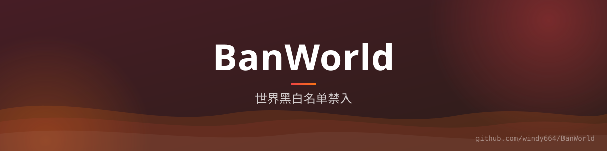

<div align="center">



# BanWorld

**世界黑白名单** —— 黑名单或白名单两种模式，控制玩家能进入哪些世界。


[功能](#-功能) · [配置](#️-配置)

</div>

## ✨ 功能

- **黑名单模式**：`blacklisted_worlds` 中的世界禁止进入（默认开启）
- **白名单模式**：只允许进入 `whitelisted_worlds` 列出的世界（`whitelist_enabled` 开启）
- **双模式互斥**：黑/白名单独立开关，按服务器管理习惯选择
- **入场拦截**：监听世界切换/传送事件，命中即取消并提示

## ⚙️ 配置

```yaml
blacklisted_worlds:
  - world_nether
  - world_the_end
whitelisted_worlds:
  - world
blacklist_enabled: true
whitelist_enabled: false
debug: false
```

## 🔨 构建

```bash
./gradlew build
```
